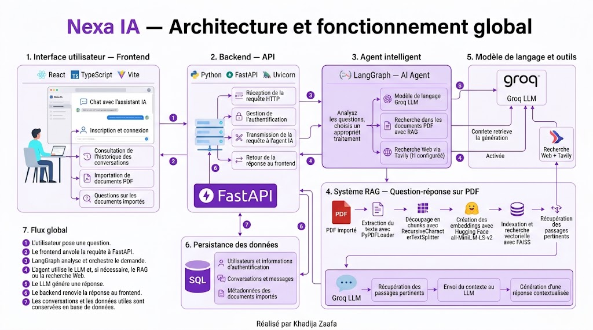

# Nexa IA — Intelligent AI Assistant 🤖

## Présentation

**Nexa IA** est une application web d’intelligence artificielle qui permet aux utilisateurs de dialoguer avec un assistant intelligent, d’interroger des documents PDF et d’effectuer des recherches sur le Web lorsque l’outil correspondant est configuré.

Le projet combine un frontend moderne, une API backend et un agent IA capable d’orchestrer différents traitements.

## Fonctionnalités principales

- 💬 **Chat IA :** poser des questions et obtenir des réponses générées par un modèle de langage.
- 📄 **Gestion des documents :** importer des fichiers PDF et préparer leur contenu pour la recherche.
- 🔎 **RAG (Retrieval-Augmented Generation) :** retrouver des passages pertinents dans les documents pour enrichir les réponses.
- 🌐 **Recherche Web :** récupérer des informations externes lorsque l’outil de recherche est disponible.
- 🔐 **Authentification :** inscription, connexion et protection des routes API.
- 🗂️ **Historique :** consulter les conversations enregistrées et gérer les documents importés.

## Architecture

Le projet repose sur une architecture frontend/backend :

- **Frontend :** React, TypeScript et Vite.
- **Backend :** Python, FastAPI et Uvicorn.
- **Agent IA :** LangGraph.
- **Modèle de langage :** intégration Groq.
- **Traitement documentaire :** LangChain et PyPDFLoader.
- **Embeddings :** Hugging Face (`all-MiniLM-L6-v2`).
- **Recherche vectorielle :** FAISS.
- **Recherche Web :** Tavily Search, si configuré.
- **Persistance :** base de données SQL pour les données prises en charge par le backend.

## Fonctionnement

1. L’utilisateur se connecte et pose une question depuis l’interface.
2. Le frontend transmet la demande à l’API FastAPI.
3. L’agent IA traite la demande et utilise les outils nécessaires selon sa configuration.
4. Pour les questions documentaires, le système RAG recherche les passages pertinents dans les PDF indexés.
5. Le modèle de langage génère une réponse et l’API la renvoie à l’utilisateur.

## 🏗️ Architecture et fonctionnement

Le schéma suivant présente l’architecture globale de **Nexa IA**, les principales technologies utilisées et le flux de traitement des requêtes, du frontend jusqu’à la génération de la réponse par l’agent IA.




## Installation et lancement

### Backend

```bash
python -m venv .venv
```

Sous Windows :

```powershell
.venv\Scripts\Activate.ps1
```

Installer les dépendances :

```bash
pip install -r requirements.txt
```

Configurer les variables d’environnement nécessaires, puis lancer l’API depuis le dossier contenant `api.py` :

```bash
uvicorn api:app --reload
```

Documentation API : `http://127.0.0.1:8000/docs`

### Frontend

```bash
npm install
```

Créer un fichier `.env` contenant :

```env
VITE_API_URL=http://127.0.0.1:8000
```

Lancer l’application :

```bash
npm run dev
```

## Sécurité

Les clés API et les secrets doivent rester dans les variables d’environnement. Les routes protégées doivent vérifier les autorisations des utilisateurs, et les conversations comme les documents doivent être isolés entre comptes.

## Améliorations possibles

- Ajouter des tests automatisés.
- Améliorer les citations des sources documentaires et Web.
- Renforcer la persistance de la mémoire de l’agent.
- Préparer le déploiement et la surveillance en production.

---

**Nexa IA** — Projet d’intelligence artificielle combinant assistant conversationnel, RAG et recherche Web.
---

**Réalisé par Khadija Zaafa**  
*Projet d’Intelligence Artificielle — Nexa IA*